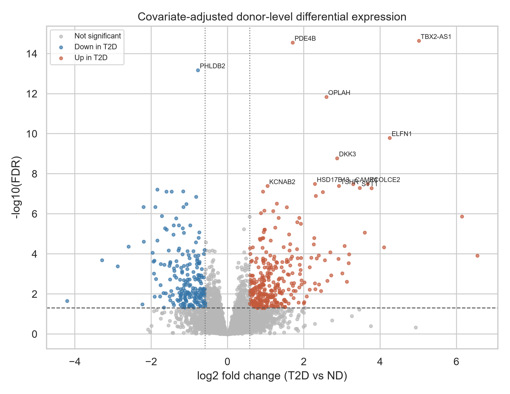
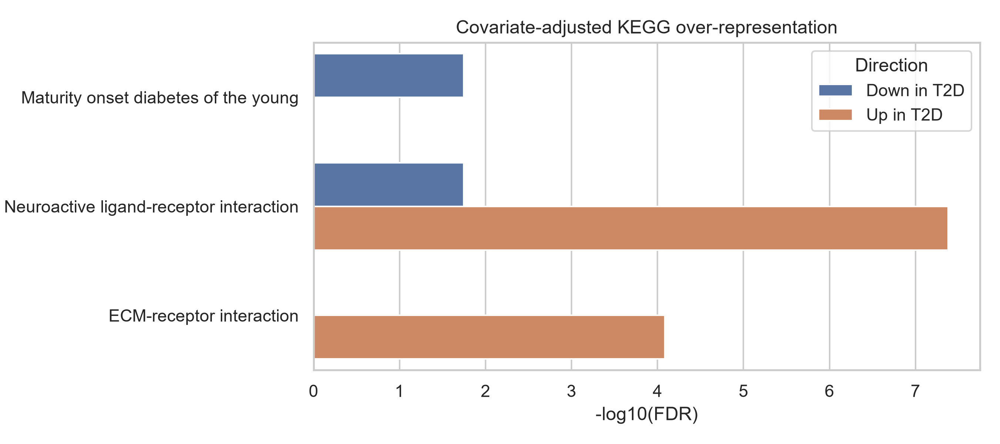
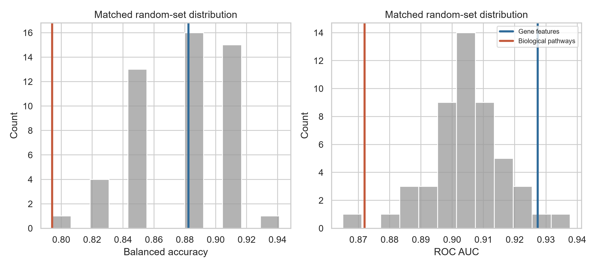
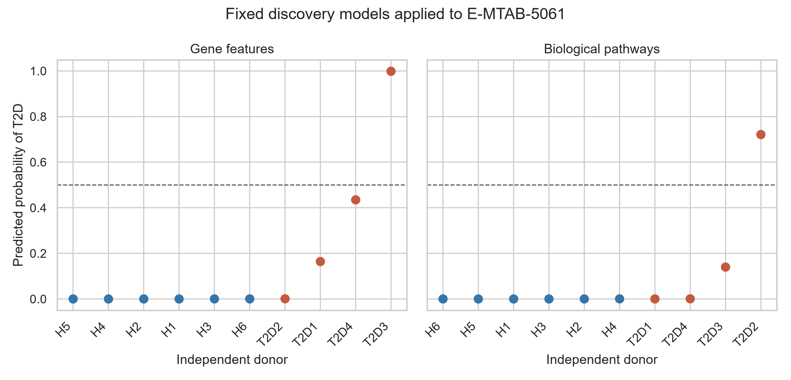

# Pathway-Aware Single-Cell Analysis of Type 2 Diabetes

- **Author:** Tharuniya Anpalakan
- **Programme:** Biomedical Science Undergraduate
- **Repository:** <https://github.com/tharuniya26/Project2_Pathway_SingleCell>
- **Analysis finalized:** 5 November 2026

## Abstract

High-dimensional gene expression can classify disease in small transcriptomic cohorts, but it may be unstable across studies. This project tested whether curated pathway-level summaries provide a more reproducible Type 2 diabetes (T2D) signal than individual genes or matched random gene sets. Raw beta-cell counts from GSE221156 were aggregated by donor. The discovery contrast comprised 17 non-diabetic (ND) and 17 T2D donors, representing 63,350 beta cells. Covariate-adjusted negative-binomial analysis identified 927 genes at false-discovery rate (FDR) <0.05; 520 also met |log2 fold change| >= log2(1.5). Mean log-CPM scores were constructed for 291 KEGG pathways and compared with 17,408 genes and 50 random representations matched for set size and gene-expression decile. Under donor-level repeated five-fold cross-validation, gene, pathway, and random-set ROC AUCs were 0.927, 0.872, and 0.905 (random mean), respectively. Fixed discovery models were tested without refitting in ten independent E-MTAB-5061 donors; ROC AUCs were 1.000, 0.833, and 0.916, respectively. The pathway model was at the 2nd percentile of internal and 16th percentile of external random controls, with no evidence of pathway superiority (one-sided empirical *p*=0.980 and 0.922). Pathway analysis nevertheless provided interpretable associations, including increased neuroactive ligand-receptor and extracellular-matrix programmes and reduced expression of genes in a maturity-onset diabetes of the young set. The central hypothesis was therefore not supported: in these cohorts, pathway averaging compressed the data but did not confer a reproducibility advantage over genes or matched random sets. Small donor counts, protocol differences, confounding, and probability miscalibration require conservative interpretation.

## 1. Introduction

T2D involves insulin resistance together with progressive pancreatic beta-cell dysfunction. Single-cell RNA sequencing can isolate beta-cell-specific changes that would be diluted in whole-islet measurements, but cells from one donor are not independent biological replicates. Analyses that treat thousands of cells as independent can severely underestimate uncertainty. This project therefore uses donor-level pseudobulk profiles throughout.

Gene-level profiles contain many more variables than donors. Biological pathways offer a plausible compression: correlated genes can be summarized into a smaller set of mechanistically labelled features. However, averaging arbitrary groups of expressed genes can also reduce noise. A pathway model should therefore be compared not only with individual genes, but with random gene sets matched to the same size and expression structure.

## 2. Research rationale

The original repository had already completed a donor-level DESeq2 contrast, KEGG scoring, repeated cross-validation, and an E-MTAB-5061 pathway-model test. It had not implemented the matched-random control required by the central question, and it had not externally tested the gene-level baseline. The completed workflow preserves the earlier results while adding covariate-adjusted differential expression, fixed-fold three-way comparisons, uncertainty estimates, randomization tests, comparative external validation, automated checks, and reproducible scripts.

## 3. Objectives

1. Validate GSE221156 donor metadata and beta-cell pseudobulk alignment.
2. Estimate donor-level T2D differential expression while accounting for measured covariates.
3. Identify interpretable T2D-associated KEGG pathways using the tested-gene background.
4. Compare individual genes, biological pathways, and matched random gene sets using outcome-blind feature construction and donor-level validation.
5. Test fixed discovery models in a genuinely independent human beta-cell cohort.
6. Determine whether the results support a pathway-specific reproducibility advantage.

## 4. Datasets

### 4.1 Discovery cohort: GSE221156

[GSE221156](https://www.ncbi.nlm.nih.gov/geo/query/acc.cgi?acc=GSE221156) profiles human pancreatic islets with 10x Genomics v2/v3 chemistry. The GEO record contains 54 library records representing 48 donors: 17 ND, 14 prediabetic (PD), and 17 T2D. The associated study reports 245,878 cells and 14 cell types. Its published pseudobulk workflow aggregates raw counts by cell type and donor.

The primary analysis used all 17 ND and all 17 T2D beta-cell pseudobulks; 14 PD donors were excluded because the prespecified endpoint was binary T2D versus ND. No ND or T2D donor was removed. The included pseudobulks contained 39,484 beta cells from ND donors and 23,866 from T2D donors (63,350 total). Median beta-cell counts were 2,566 and 1,311 per donor, respectively.

### 4.2 Independent cohort: E-MTAB-5061

[E-MTAB-5061](https://www.ebi.ac.uk/biostudies/arrayexpress/studies/E-MTAB-5061) is the Segerstolpe *et al.* Smart-seq2 study of human pancreatic islets. The processed matrix contains both RPKM and raw-count blocks. Metadata-defined beta cells were selected, yielding 270 cells from six ND and four T2D donors. Raw counts were summed within donor, producing ten external pseudobulks. No external outcome label was used to select genes, pathways, features, thresholds, or model parameters.

### 4.3 Independence and compatibility

The discovery and external accessions are from different studies, donors, laboratories, protocols, and years. The external analysis is therefore genuinely independent, not an internal holdout. Compatibility was restricted to gene symbols measurable after cohort-specific expression filtering. This yielded 10,674 common genes and 277 pathways with at least ten common genes.

## 5. Materials and methods

### 5.1 Metadata and integrity checks

The GEO series matrix was parsed into one record per GSM. Count columns were required to exactly match donor metadata rows. Gene and donor identifiers had to be unique, counts non-negative and integer-valued, and both primary classes had to contain 17 donors. All automated integrity checks passed.

### 5.2 Pseudobulk preparation and QC

Raw beta-cell counts had already been summed by donor in the source workflow. Genes were retained if they had at least ten counts in at least five discovery donors, leaving 17,408 genes. For visualization and prediction, each donor was normalized to counts per million (CPM) and transformed as log2(CPM+1). External duplicate gene symbols were summed before applying the same expression rule. Donor library size, detected genes, beta-cell count, disease status, chemistry, sex, race, age, BMI, and HbA1c were retained for QC.

### 5.3 Differential expression

PyDESeq2 0.5.3 fitted donor-level negative-binomial models to raw pseudobulk counts. The design was:

```text
~ Chemistry + Sex + Race + BMI + Condition
```

The contrast was T2D versus ND. Benjamini-Hochberg-adjusted *p*<0.05 defined statistical significance; |log2FC| >= log2(1.5) was additionally required for the effect-size-filtered gene set. This covariate set follows the GSE221156 study's reported glycaemic-state analysis. The earlier chemistry-only DESeq2 result is retained for provenance but is not the primary completed result.

### 5.4 Pathway analysis

KEGG 2021 Human definitions were obtained through Enrichr/GSEApy. Pathways with 10-200 expressed discovery genes were retained (291 pathways). Up- and downregulated effect-size-filtered genes were tested separately by a hypergeometric over-representation test using all 17,408 tested genes as the background. FDR correction was performed across the 291 pathways within each direction.

### 5.5 Feature representations

- **Genes:** one log2(CPM+1) value per filtered gene (17,408 features).
- **Biological pathways:** mean log2(CPM+1) of the genes in each retained KEGG set (291 features).
- **Matched random sets:** 50 independently sampled representations. For every pathway, the random set retained the same number of genes and the same distribution across ten mean-expression deciles. Sampling was without replacement within a set. The process used no disease labels.

### 5.6 Internal validation

All representations used identical stratified five-fold partitions repeated ten times (50 train/test splits). Standardization was fitted only on each training fold. A prespecified L2 logistic regression (`C=1`, liblinear solver) was used without outcome-driven feature selection or tuning. Each donor received one out-of-fold probability per repeat; probabilities were averaged across repeats before computing accuracy, balanced accuracy, and ROC AUC. Stratified donor bootstrap resampling (2,000 iterations) produced exploratory 95% intervals for the fixed gene and pathway representations. Random-control intervals are the 2.5th-97.5th percentiles across 50 independently sampled representations.

### 5.7 External validation

Gene and pathway models were fitted once to all 34 discovery donors and applied without refitting to the ten external donors. The gene model used 10,674 common genes. The pathway model used exactly the same common genes within each of 277 retained pathways in both cohorts. Fifty external random representations were constructed from the common-gene universe with the same matching rule. The 0.5 threshold was fixed in advance; ROC AUC was used to separate ranking from calibration.

### 5.8 Software and reproducibility

The canonical Python 3.12 workflow is implemented in `src/run_adjusted_differential_expression.py`, `src/run_comparative_analysis.py`, and `src/validate_project.py`. Exact Python versions are pinned in `requirements.txt`. `run_all.ps1` executes the complete workflow. Random seeds, folds, thresholds, and model hyperparameters are fixed in code.

## 6. Results

### 6.1 Cohort QC and measured imbalance

All 34 primary donor profiles passed structural checks. Chemistry was not detectably associated with condition (Fisher exact *p*=0.465), and age did not differ detectably (Mann-Whitney *p*=0.227). T2D donors had higher BMI (means 33.0 versus 28.4 kg/m2; *p*=0.023) and fewer sampled beta cells (means 1,404 versus 2,323; *p*=0.0059). These differences motivate covariate adjustment and remain limitations for predictive interpretation.


The PCA shows substantial chemistry-associated structure, particularly among v2 samples. Chemistry was not detectably associated with disease by Fisher's exact test, but technical effects are visibly present and cannot be considered absent.

### 6.2 Differential expression

The adjusted model tested 17,408 genes. It identified 927 at FDR <0.05. Of these, 520 also met |log2FC| >= log2(1.5): 321 were higher and 199 lower in T2D. Leading results included higher TBX2-AS1, PDE4B, OPLAH, ELFN1, DKK3, and SYT1 and lower PHLDB2, OPRD1, and FOXA3. Several agree in direction with genes emphasized by the GSE221156 publication, but this analysis is an independent reimplementation and not a claim of exact replication.

The earlier chemistry-adjusted DESeq2 table contained 1,334 FDR-significant genes; 660 met the same effect threshold. The stricter adjusted analysis and earlier result shared 457 effect-size-filtered genes (Jaccard index 0.632), demonstrating both a stable core and sensitivity to covariate specification. The source publication reported 511 effect-size-filtered beta-cell DEGs (316 up and 195 down); the present count is similar, but differences in software and implementation mean it is not an exact replication.



### 6.3 Pathway enrichment

Four KEGG tests passed directional FDR <0.05:

| Direction | Pathway | Overlap | FDR |
|---|---|---:|---:|
| Up in T2D | Neuroactive ligand-receptor interaction | 17/125 | 4.16x10^-8 |
| Up in T2D | ECM-receptor interaction | 9/54 | 8.22x10^-5 |
| Down in T2D | Maturity onset diabetes of the young | 4/23 | 0.0180 |
| Down in T2D | Neuroactive ligand-receptor interaction | 8/125 | 0.0180 |

The neuroactive pathway appears in both directions because non-overlapping receptor/signalling subsets change in opposite directions. The downregulated maturity-onset diabetes set contained FOXA3, HNF1A, HNF4A, and SLC2A2. These are expression associations and do not demonstrate causality or diagnose monogenic diabetes.



### 6.4 Internal representation comparison

| Model | Features | Balanced accuracy (95% interval) | ROC AUC (95% interval) |
|---|---:|---:|---:|
| Individual genes | 17,408 | 0.882 (0.765-0.971) | 0.927 (0.810-1.000) |
| KEGG pathways | 291 | 0.794 (0.647-0.912) | 0.872 (0.734-0.979) |
| Matched random sets | 291 | 0.878 mean (0.824-0.912) | 0.905 mean (0.880-0.927) |

Pathways reduced dimensionality by 98.3% relative to the gene matrix but also reduced discrimination. Only one of 50 matched-random representations had ROC AUC at or below the pathway value. The pathway score was therefore at the 2nd random-control percentile; the one-sided empirical *p* for pathway superiority was 0.980. This directly contradicts a pathway-specific performance advantage in the discovery cohort.




### 6.5 Independent external validation

| Model | Features | Accuracy | Balanced accuracy | ROC AUC |
|---|---:|---:|---:|---:|
| Individual genes | 10,674 | 0.700 | 0.625 | 1.000 |
| KEGG pathways | 277 | 0.700 | 0.625 | 0.833 |
| Matched random sets | 277 | 0.778 mean | 0.782 mean | 0.916 mean |

The fixed gene model ranked every ND-T2D donor pair correctly but classified only one of four T2D donors at the 0.5 threshold, showing severe cross-study probability shift. The pathway model retained useful ranking but also missed three of four T2D donors. Across 50 random representations, external ROC AUC ranged from 0.708 to 1.000. The pathway value was at the 16th random-control percentile, again providing no evidence of superiority (one-sided empirical *p*=0.922).



The external AUC=1.000 is based on only four T2D and six ND donors--24 cross-class pairs. Its degenerate donor-bootstrap interval does not capture between-cohort uncertainty and must not be interpreted as clinical accuracy.

## 7. Discussion

### 7.1 Answer to the central question

The study does not support the hypothesis that curated pathway means are more reproducible than genes or matched random gene sets. Gene features performed best in both internal and external ranking. More importantly, random gene-set means generally outperformed biological pathway means. This indicates that variance reduction through averaging broad expression signal can explain much of the apparent benefit of pathway aggregation.

### 7.2 What pathway features still contribute

Failure to improve predictive performance does not make pathway analysis uninformative. KEGG scores reduced 17,408 gene measurements to 291 interpretable summaries and highlighted neuroactive, extracellular-matrix, and beta-cell identity programmes consistent with the biological context. Their value here is interpretation and compression, not demonstrated predictive superiority.

### 7.3 Biological interpretation

Increased neuroactive ligand-receptor genes are consistent with altered receptor and electrical-signalling programmes in T2D beta cells. Increased ECM-receptor genes may reflect altered cell-matrix interactions or stress-related remodelling. Reduced HNF1A/HNF4A/SLC2A2-related expression is compatible with compromised mature beta-cell identity. However, donor differences, medication, disease duration, islet isolation, cell-state composition, BMI, and technical protocol could contribute. The analyses establish associations, not causal mechanisms.

### 7.4 Why external ranking and threshold performance differ

GSE221156 uses droplet-based 10x data, whereas E-MTAB-5061 uses plate-based Smart-seq2. Even after CPM normalization, platform-specific distributions remain. A scaler learned in the discovery cohort cannot guarantee calibrated external probabilities. ROC AUC depends on ranking and can remain high while a fixed 0.5 threshold performs poorly. Because calibrating on the ten external labels would leak test information, no post-hoc recalibration was performed.

## 8. Limitations

1. **Small donor samples.** There are 34 discovery and ten external donors. Repeated CV measures split sensitivity but does not create more independent biological samples.
2. **Wide and sometimes degenerate uncertainty.** Ten external donors cannot support precise performance estimates; perfect observed ranking produces an uninformative degenerate bootstrap AUC interval.
3. **Measured confounding.** BMI and beta-cell yield differ by disease group. DE adjusts for BMI, chemistry, sex, and race, but prediction may still use correlated biological or technical variation.
4. **Platform shift.** 10x and Smart-seq2 have different sensitivity, dropout, and count distributions.
5. **Outcome-blind but cohort-wide filtering.** Expression filtering and expression-decile matching use the discovery feature matrix without labels. They do not use outcomes, but they are not re-estimated independently inside every internal fold.
6. **Simple pathway score.** A mean ignores gene direction, topology, cell-state specificity, and opposing effects within a pathway.
7. **Pathway-resource dependence.** KEGG definitions overlap, evolve, and do not cover all beta-cell biology.
8. **External phenotype detail.** Medication, disease duration, and some covariates could not be harmonized sufficiently for multivariable external analysis.
9. **No clinical claim.** This retrospective molecular classification is not a diagnostic model and has not been prospectively or clinically validated.

## 9. Conclusion

Donor-level analysis identified a reproducible T2D-associated beta-cell expression signal and biologically interpretable pathway changes. However, the prespecified central hypothesis was not supported. KEGG pathway means were more compact than gene features, but they were less discriminative than genes and usually less discriminative than matched random gene-set means, both internally and in the independent cohort. The defensible conclusion is therefore negative but informative: simple biological pathway averaging does not, by itself, provide evidence of superior cross-cohort reproducibility in these small human islet datasets.

## 10. Figures and tables

Primary machine-readable outputs are:

- `results/tables/beta_T2D_vs_ND_pydeseq2_adjusted.csv`
- `results/tables/adjusted_KEGG_overrepresentation.csv`
- `results/metrics/internal_model_performance.csv`
- `results/metrics/internal_random_gene_set_performance.csv`
- `results/metrics/external_model_performance.csv`
- `results/metrics/external_random_gene_set_performance.csv`
- `results/metrics/pathway_vs_random_diagnostics.csv`
- `results/metrics/external_comparative_predictions.csv`

See `FINAL_VALIDATION_REPORT.md` for the execution audit. A typeset version of this report is available as `Tharuniya_Anpalakan_Project2_Research_Report.pdf`.

## 11. References

1. Bandesh K, Motakis E, Nargund S, *et al.* Deep single-cell decoding of human pancreatic islets reveals T2D beta-cell gene expression defects. *The EMBO Journal*. 2026;45:3978-4005. [doi:10.1038/s44318-026-00744-w](https://doi.org/10.1038/s44318-026-00744-w).
2. Segerstolpe A, Palasantza A, Eliasson P, *et al.* Single-cell transcriptome profiling of human pancreatic islets in health and type 2 diabetes. *Cell Metabolism*. 2016;24:593-607. [doi:10.1016/j.cmet.2016.08.020](https://doi.org/10.1016/j.cmet.2016.08.020).
3. Love MI, Huber W, Anders S. Moderated estimation of fold change and dispersion for RNA-seq data with DESeq2. *Genome Biology*. 2014;15:550. [doi:10.1186/s13059-014-0550-8](https://doi.org/10.1186/s13059-014-0550-8).
4. Muzellec B, Telenczuk M, Cabeli V, Andreux M. PyDESeq2: a Python package for bulk RNA-seq differential expression analysis. *Bioinformatics*. 2023;39:btad547. [doi:10.1093/bioinformatics/btad547](https://doi.org/10.1093/bioinformatics/btad547).
5. Squair JW, Gautier M, Kathe C, *et al.* Confronting false discoveries in single-cell differential expression. *Nature Communications*. 2021;12:5692. [doi:10.1038/s41467-021-25960-2](https://doi.org/10.1038/s41467-021-25960-2).
6. Crowell HL, Soneson C, Germain P-L, *et al.* muscat detects subpopulation-specific state transitions from multi-sample multi-condition single-cell transcriptomics data. *Nature Communications*. 2020;11:6077. [doi:10.1038/s41467-020-19894-4](https://doi.org/10.1038/s41467-020-19894-4).
7. Kanehisa M, Goto S. KEGG: Kyoto Encyclopedia of Genes and Genomes. *Nucleic Acids Research*. 2000;28:27-30. [doi:10.1093/nar/28.1.27](https://doi.org/10.1093/nar/28.1.27).
8. Kuleshov MV, Jones MR, Rouillard AD, *et al.* Enrichr: a comprehensive gene set enrichment analysis web server 2016 update. *Nucleic Acids Research*. 2016;44:W90-W97. [doi:10.1093/nar/gkw377](https://doi.org/10.1093/nar/gkw377).
9. Fang Z, Liu X, Peltz G. GSEApy: a comprehensive package for performing gene set enrichment analysis in Python. *Bioinformatics*. 2023;39:btac757. [doi:10.1093/bioinformatics/btac757](https://doi.org/10.1093/bioinformatics/btac757).
10. Pedregosa F, Varoquaux G, Gramfort A, *et al.* Scikit-learn: machine learning in Python. *Journal of Machine Learning Research*. 2011;12:2825-2830.
11. Varoquaux G. Cross-validation failure: small sample sizes lead to large error bars. *NeuroImage*. 2018;180:68-77. [doi:10.1016/j.neuroimage.2017.06.061](https://doi.org/10.1016/j.neuroimage.2017.06.061).
12. Benjamini Y, Hochberg Y. Controlling the false discovery rate: a practical and powerful approach to multiple testing. *Journal of the Royal Statistical Society B*. 1995;57:289-300. [doi:10.1111/j.2517-6161.1995.tb02031.x](https://doi.org/10.1111/j.2517-6161.1995.tb02031.x).
