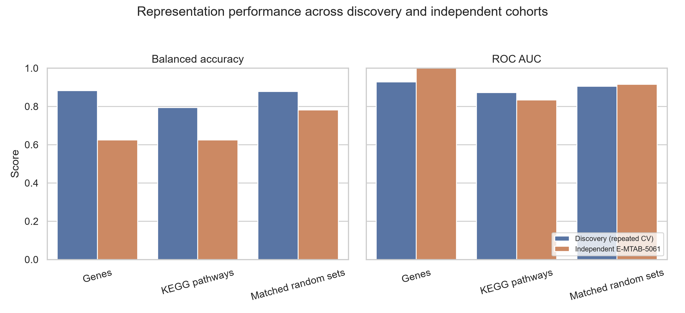
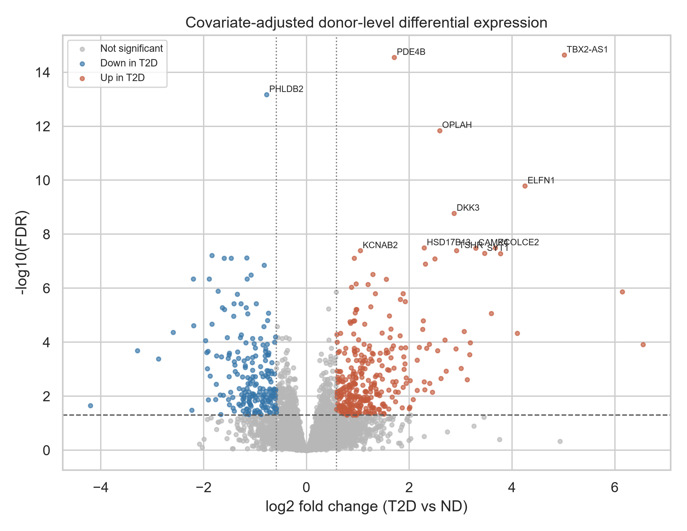
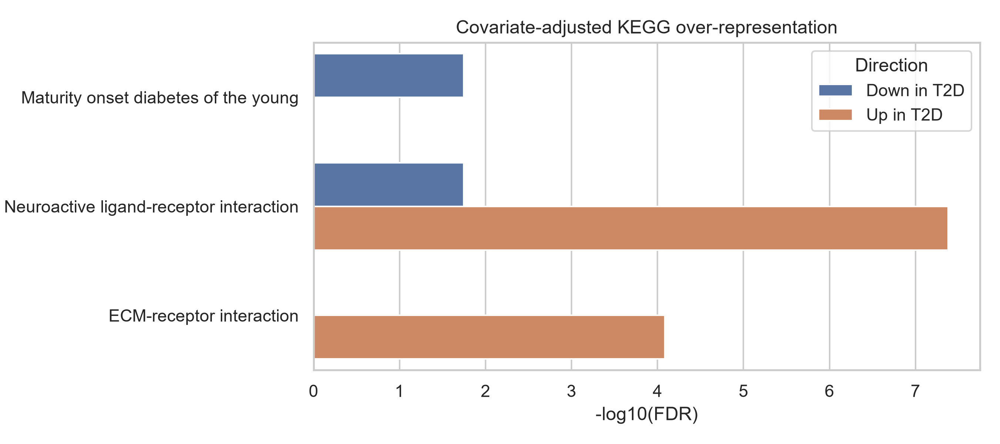

# Pathway-Aware Single-Cell Analysis of Type 2 Diabetes

Donor-level analysis of human pancreatic beta-cell transcriptomes testing whether curated pathway representations produce more reproducible Type 2 diabetes (T2D) signals than individual genes or size- and expression-matched random gene sets.

- **Author:** Tharuniya Anpalakan, Biomedical Science Undergraduate
- **GitHub:** [tharuniya26](https://github.com/tharuniya26)
- **ResearchGate:** [Tharuniya Anpalakan](https://www.researchgate.net/profile/Tharuniya-Anpalakan)

## Research question and answer

> Do biologically informed pathway-level representations provide more reproducible T2D signals than gene-level representations and matched random gene sets across independent cohorts?

In these data, **no**. KEGG pathway scores were compact and interpretable, but they did not outperform either the individual-gene model or 50 matched-random controls.

| Representation | Features | Discovery balanced accuracy | Discovery ROC AUC | External balanced accuracy | External ROC AUC |
|---|---:|---:|---:|---:|---:|
| Individual genes | 17,408 discovery / 10,674 shared | 0.882 | 0.927 | 0.625 | 1.000 |
| KEGG pathway scores | 291 discovery / 277 matched | 0.794 | 0.872 | 0.625 | 0.833 |
| Matched random gene sets | 291 / 277 | 0.878 mean | 0.905 mean | 0.782 mean | 0.916 mean |

The pathway ROC AUC was at the 2nd percentile of the internal random-control distribution and the 16th percentile externally. One-sided empirical tests provided no evidence that pathways were superior to matched random sets (internal *p*=0.980; external *p*=0.922). The external cohort has only ten donors, so all external estimates are exploratory.



## Datasets

- **Discovery:** [GSE221156](https://www.ncbi.nlm.nih.gov/geo/query/acc.cgi?acc=GSE221156), 48 human pancreatic-islet donors (17 non-diabetic, 14 prediabetic, 17 T2D). The primary binary analysis uses all 17 non-diabetic and all 17 T2D beta-cell pseudobulks; prediabetic donors are excluded from that contrast.
- **Independent external validation:** [E-MTAB-5061](https://www.ebi.ac.uk/biostudies/arrayexpress/studies/E-MTAB-5061), 270 beta cells from six non-diabetic and four T2D donors, aggregated to ten donor pseudobulks. These donors are independent of GSE221156.

Large raw and processed data are intentionally excluded from Git. See [Data acquisition](#data-acquisition) below.

## Completed analyses

- GEO metadata and donor-alignment validation
- donor-level beta-cell pseudobulk QC and log-CPM normalization
- covariate-adjusted negative-binomial differential expression
- background-aware KEGG over-representation analysis
- fixed-fold, repeated donor-level cross-validation
- individual-gene, KEGG-pathway, and 50 matched-random-set comparisons
- fixed-model external validation in E-MTAB-5061
- stratified donor bootstrap intervals and randomization distributions
- automated integrity and output checks

The adjusted differential-expression model (`~ chemistry + sex + race + BMI + condition`) identified 927 genes at FDR < 0.05; 520 also met |log2FC| >= log2(1.5), comprising 321 higher and 199 lower in T2D. Significant KEGG over-representation included neuroactive ligand-receptor and ECM-receptor interaction among T2D-up genes, and maturity-onset diabetes of the young plus a distinct subset of neuroactive ligand-receptor genes among T2D-down genes.





## Methods in brief

Raw beta-cell counts were summed by biological donor. Genes were retained at >=10 counts in at least five discovery donors. Models used log2(CPM+1) data and L2-regularized logistic regression (`C=1`) with scaling fitted inside each training fold. Internal evaluation used the same repeated stratified five-fold splits (10 repeats) for every representation. No outcome-driven feature selection was performed.

Each KEGG score is the mean expression of the pathway's genes. Fifty random representations preserve every pathway's gene count and mean-expression-decile composition. External models were trained only on GSE221156 and applied without refitting to E-MTAB-5061. The full methods, numerical results, interpretation, and limitations are in [PROJECT_REPORT.md](PROJECT_REPORT.md).

## Reproducibility

### 1. Environment

Windows PowerShell:

```powershell
py -3.12 -m venv .venv
.\.venv\Scripts\python.exe -m pip install --upgrade pip
.\.venv\Scripts\python.exe -m pip install -r requirements.txt
```

Alternatively, use the supplied Conda environment, which also includes R and DESeq2 for the historical R analysis:

```powershell
conda env create -f environment.yml
conda activate pathway-singlecell
```

`pandas==2.3.3` is intentionally pinned because PyDESeq2 0.5.3 is incompatible with pandas 3.0 during dispersion fitting.

### 2. Data acquisition

Expected local files:

```text
data/metadata/GSE221156_series_matrix.txt.gz
data/processed/beta_counts.csv
data/processed/beta_design.csv
data/raw/E-MTAB-5061/E-MTAB-5061.sdrf.txt
data/raw/E-MTAB-5061/pancreas_refseq_rpkms_counts_3514sc.txt
```

The GSE221156 pseudobulk object was obtained from the study's public supplementary R workflow (`BetaPseudobulk.rds`) and exported using `src/inspect_beta_pseudobulk.R`. E-MTAB-5061 files are available from its BioStudies/ArrayExpress record. The analysis downloads the Enrichr `KEGG_2021_Human` library into the ignored `data/cache/` directory on first use.

### 3. Execute

```powershell
.\run_all.ps1
```

Or run stages directly:

```powershell
.\.venv\Scripts\python.exe src\run_adjusted_differential_expression.py --n-cpus 1 --quiet
.\.venv\Scripts\python.exe src\run_comparative_analysis.py
.\.venv\Scripts\python.exe src\validate_project.py
```

The canonical executable workflow is in `src/`. Notebooks are retained as an exploratory record of the earlier analysis and are not required by the canonical runner.

To rebuild the typeset report from the authoritative Markdown source, install XeLaTeX (MiKTeX or TeX Live) with Times New Roman available, then run:

```powershell
.\.venv\Scripts\python.exe src\build_report_pdf.py
```

This writes `Tharuniya_Anpalakan_Project2_Research_Report.pdf` directly from `PROJECT_REPORT.md`.

## Project structure

```text
src/                       canonical analysis and validation scripts
notebooks/                 exploratory analysis history
data/metadata/             small GEO metadata file
data/raw/, data/processed/ ignored large inputs and generated caches
results/figures/           publication-style figures
results/tables/            DE, enrichment, definitions, and QC tables
results/metrics/           predictions, uncertainty, and model comparisons
paper/                     earlier IEEE-format manuscript draft
PROJECT_REPORT.md          complete scientific report
Tharuniya_Anpalakan_Project2_Research_Report.pdf  typeset final report
FINAL_VALIDATION_REPORT.md final execution and limitation audit
```

## Important limitations

- The discovery cohort has 34 donors and the external cohort only ten; repeated CV does not increase the number of independent people.
- BMI and beta-cell yield differ between discovery disease groups. DE adjusts for BMI and measured technical/demographic covariates, but predictive models may still contain clinical or technical confounding.
- E-MTAB-5061 uses Smart-seq2 whereas GSE221156 uses 10x Genomics; absolute probabilities are poorly calibrated across protocols.
- AUC=1.0 for the external gene model reflects only 24 cross-class donor pairs and is not evidence of clinical readiness.
- Pathway databases overlap, are incomplete, and simple mean scores can conceal opposing gene effects.
- The random-control analysis shows that much of the predictive benefit can arise from averaging broad expression signal, not pathway annotation specifically.

## Future work

Priority extensions are validation in larger donor cohorts, nested tuning or prespecified low-dimensional gene baselines, calibration methods learned without external labels, covariate-balanced sampling, and evaluation of alternative pathway scores such as rank-based or signed methods.

## Reports

- [Complete project report](PROJECT_REPORT.md)
- [Typeset PDF research report](Tharuniya_Anpalakan_Project2_Research_Report.pdf)
- [Final validation report](FINAL_VALIDATION_REPORT.md)
- [Progress log](PROGRESS_LOG.md)

This is an undergraduate computational research portfolio project. It has not been peer reviewed and is not a clinical diagnostic tool.
